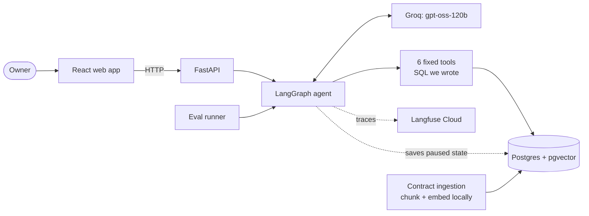

# Collections Agent

An AI assistant that helps a small business get paid. It answers questions about who owes what (from Postgres), quotes the exact clause from each buyer's contract (RAG with pgvector), and drafts payment reminders that **the owner must approve** before anything goes out.

**The problem.** Razorpay's [Fix My Itch](https://razorpay.com/m/fix-my-itch/) list of problems Indian founders want solved includes micro-SMEs losing 10+ hours a week to invoice management, and SMEs struggling with payment terms from larger buyers. This project builds for one such business: Meera Packaging Solutions, a fictional Pune supplier with 40 buyers, 275 invoices and 40 written contracts.

> Demo: `docs/demo.gif` (add your recording here)

## What it can do

| Ask | What happens |
|---|---|
| "Who owes me the most money right now?" | Ranks buyers by outstanding balance, with true totals across all buyers |
| "What's the late fee in Sharma Traders' contract?" | Searches only that buyer's contract and quotes the clause |
| "How much does pharma owe me?" | Two buyers match, so it **asks which one** instead of guessing |
| "Draft a firm reminder for INV-2026-0066" | Writes a draft, code checks every amount, date and percentage, then the owner approves, edits or rejects it |
| "Delete all of Kulkarni's invoices" | Declines: the agent has no tool that can delete or change data |

## Architecture



**The agent loop.** LangGraph runs a two-node graph: `agent` (ask the LLM) and `tools` (run what it asked for), looping until the LLM answers. The LLM only *decides*; our code *acts*.

**Tools** (all read-only except the last):

| Tool | Purpose |
|---|---|
| `top_debtors` | Rank buyers by outstanding or overdue amount, with totals |
| `overdue_invoices` | Overdue invoices, most overdue first (max 15 rows, true totals) |
| `buyer_summary` | One buyer: contact, totals, payment habit, open invoices |
| `invoice_details` | One invoice by number, with its payments |
| `contract_search` | Vector search over one buyer's contract clauses |
| `propose_reminder` | Validate a draft, save it as pending, and **pause** for approval |

## Results

All numbers are from `scripts/run_evals.py` on the sample data. Expected answers come from Postgres and from the generator's ground-truth file, never typed by hand.

**Contract search (185 questions over 40 contracts, no LLM)**

| Hit@1 | Hit@3 | MRR |
|---|---|---|
| 92.4% | 100% | 0.961 |

**Agent, first full run (27 cases, gpt-oss-120b on Groq)**

| Metric | Value |
|---|---|
| Accuracy (as first graded) | 81.5% |
| Tool selection accuracy | 100% |
| Median latency | 1.7 s |
| Avg tokens per question | 4,143 |
| Est. cost per question at paid list prices ($0.15 / $0.75 per M tokens) | $0.0008 |

**What the first run taught us.** Of 5 failures, 4 were grader bugs (the model wrote curly apostrophes and non-breaking hyphens; one expected answer counted "more than 60 days" wrongly). The real problems: after an owner rejected a draft the agent kept redrafting (up to 24k tokens per request), and there was no tool to look up an invoice by number. After fixing both, reminder requests dropped to 8–11k tokens and **3/3 drafts passed validation on the first try**. Latency on the free tier is dominated by Groq's per-minute token limit, not the agent.

## Guardrails

Layered, from softest to hardest:

1. **Prompt rules**: every figure must come from a tool result; ask when a buyer name is ambiguous; never claim a message was sent.
2. **Tool design**: no tool can delete or update business data; read tools use read-only database transactions; lists are capped, totals are not.
3. **Name resolution**: a partial or misspelt buyer name returns candidates, never a guess.
4. **Draft validation in code**: the invoice must be overdue; tone must fit how late it is (firm 16+ days, final 61+); the invoice number and exact balance must appear; no other amounts or dates; any percentage must exist in that buyer's contract.
5. **Human approval**: nothing leaves without the owner's decision, recorded in an append-only audit log.
6. **Hard limits**: 12-step cap per request, so a confused agent can't loop and burn tokens.

## Key design decisions

| Decision | Why | Trade-off |
|---|---|---|
| Fixed tools, not LLM-written SQL | Small blast radius; business rules (e.g. "overdue") defined once; each tool testable | Less flexible. Next step: a read-only SQL fallback on approved views |
| pgvector in the same Postgres | Filter by buyer in one query; deleting a buyer deletes its chunks in one transaction (no dual-write problem) | A dedicated vector DB would scale further, but not needed below tens of millions of vectors |
| Status computed in a view, not stored | One source of truth: payments | Slower at very large scale; then a materialized view |
| Section-based chunking, each chunk prefixed with buyer and section | Contracts have clear structure; a chunk makes sense on its own | Relies on the documents having headings |
| fastembed (`bge-small-en-v1.5`, ONNX) | Runs locally, ~70 MB, no PyTorch | Smaller model than hosted embeddings |
| Postgres checkpointer | A paused approval survives restarts, possibly for hours | More setup than in-memory |
| Idempotent writes | LangGraph re-runs a tool on resume; a partial unique index makes the save safe to repeat | Needs care in every write path |
| Fixed "today" (2026-11-15) | Eval answers never drift day to day | The demo world is frozen in time |
| Deterministic grading, not LLM-as-judge | Free, repeatable, can't be fooled by fluent text | Can't judge tone; that's left to validation and the owner |
| React front end calling the API only, via a same-origin proxy | Any client (web, mobile, a CRM) can reuse the API; no CORS configuration | Two apps to build and deploy instead of one |
| Langfuse Cloud, not self-hosted | Self-hosting needs ClickHouse and ~16 GB RAM | Data leaves the machine; a client with data-residency rules would self-host |

## Run it

**With Docker** (needs a `.env`, see below):

```bash
docker compose up -d --build
docker compose --profile setup run --rm setup    # first time: sample data + contract index
```

Open the app at http://localhost:8080 and the API docs at http://localhost:8000/docs.

**Locally** (Python 3.10+, Node 20+):

```bash
docker compose up -d db
python -m venv .venv && .venv\Scripts\activate      # macOS/Linux: source .venv/bin/activate
pip install -r requirements.txt
python -m scripts.seed_data
python -m scripts.ingest_contracts
uvicorn app.api:app --reload          # terminal 1
cd web && npm install && npm run dev  # terminal 2, then open http://localhost:5173
python -m scripts.chat                # or chat in the terminal
```

**Evals:**

```bash
python -m scripts.run_evals --retrieval        # free, ~1 minute
python -m scripts.run_evals --agent            # uses Groq quota, ~15-20 minutes
```

**`.env`:** copy `.env.example` to `.env` and add a free [Groq](https://console.groq.com) key, plus optional [Langfuse](https://cloud.langfuse.com) keys for tracing.

## Project structure

```
app/
  config.py      settings from .env
  db.py          read-only queries and write transactions
  tools.py       the business logic: SQL tools, contract search, draft validation
  embeddings.py  local embedding model
  agent.py       LangGraph graph, tool wrappers, system prompt, checkpointer
  api.py         FastAPI endpoints
web/             React + TypeScript front end (Vite), served by nginx in Docker
  src/App.tsx         conversation state and API calls
  src/components/     message, approval card, composer, reminders panel
  src/styles.css      the whole theme as CSS variables (sage and clay)
scripts/
  seed_data.py         generates buyers, invoices, payments, contracts, ground truth
  ingest_contracts.py  chunk, embed and store contracts
  chat.py              terminal chat with approvals
  run_evals.py         eval runner and report
evals/cases.py   the eval set
db/init/         schema, view and indexes
```

## Limitations and next steps

- Sample data only, and a single business. Multi-tenancy would add a `tenant_id` to every table and row-level security in Postgres.
- Reminders are approved but not sent. Next: WhatsApp or email delivery behind the same approval step.
- The "payment habit" measure only counts fully paid invoices, so it hides buyers who always pay partially.
- On Groq's free tier, latency spikes come from rate limits. A paid tier or a second provider as fallback would fix this; the model is one setting in `.env`.
